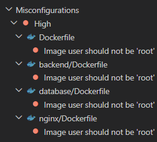
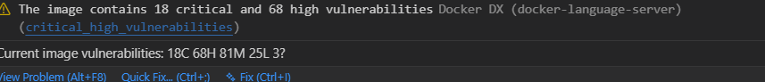
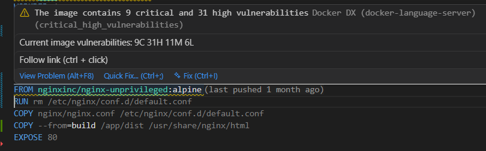
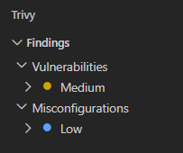
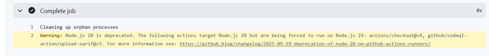
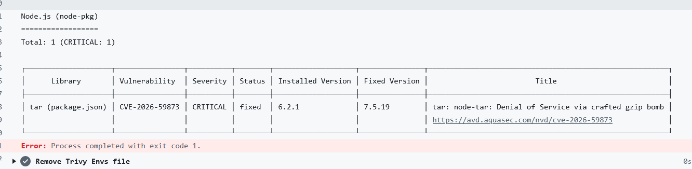
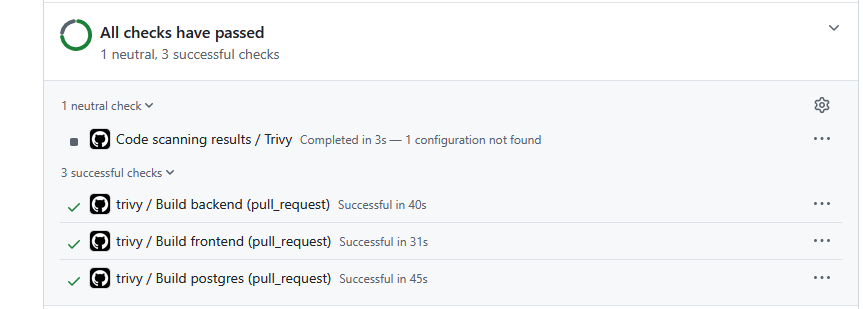

Images preuves (Trivy + CI) : 
    Trivy (extension vscode) :  
        
             
        Changement d'image pour réduire le nombre de failles :
         
         Changement après modifications des dockerfiles :
         
         les ajouts ont été : db : USER postgre ; backend : USER node front : USER 65532 ainsi que  FROM nginxinc/nginx-unprivileged:alpine3.24 (avec apk upgrade --no-cache brotli-libs dans RUN pour corriger un CVE vers la fin)

 Information dans la CI :

ignore-unfixed: true  ,permet d'ignorer les failles sans correctif

on peut mettre scan-type mais de base c'est image donc non nécessaire

exit-code: '1' -> bloque la fusion (dans notre cas nécessaire)

Exemple CI Trivy :  
 Exemple avec détail (ajouté dans le fichier trivy pour debug):
     
     résultat :  